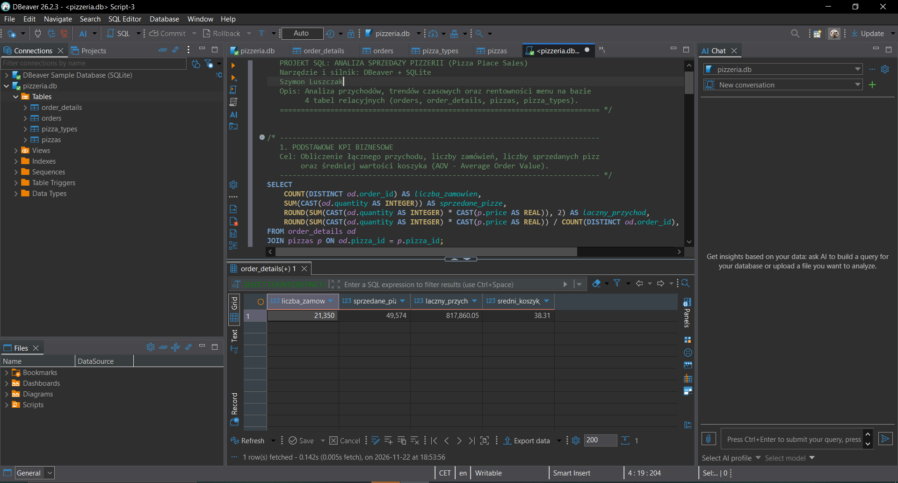
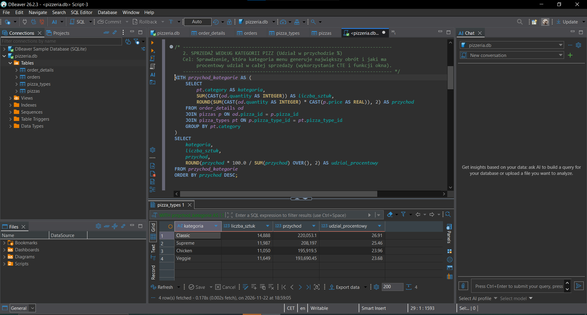
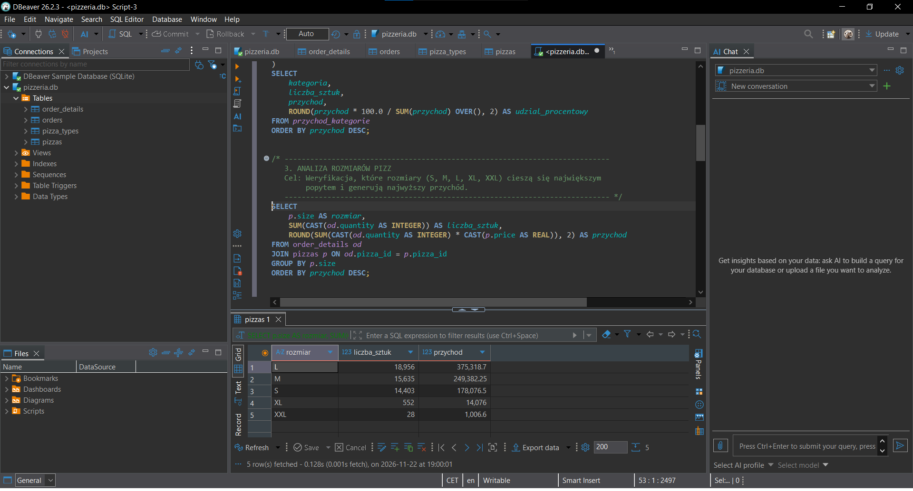
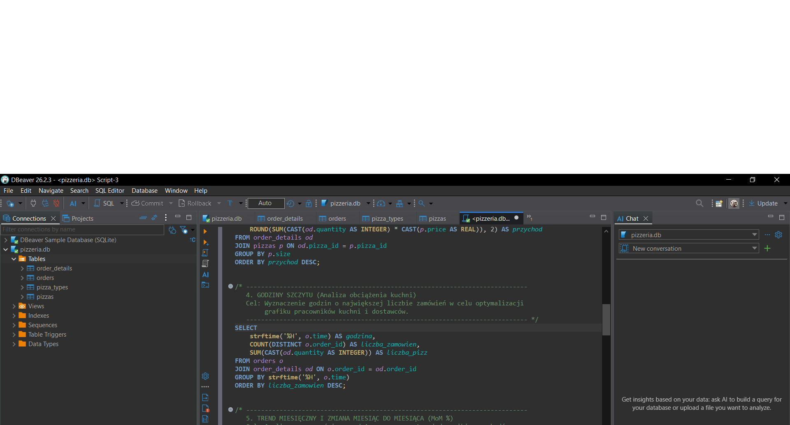
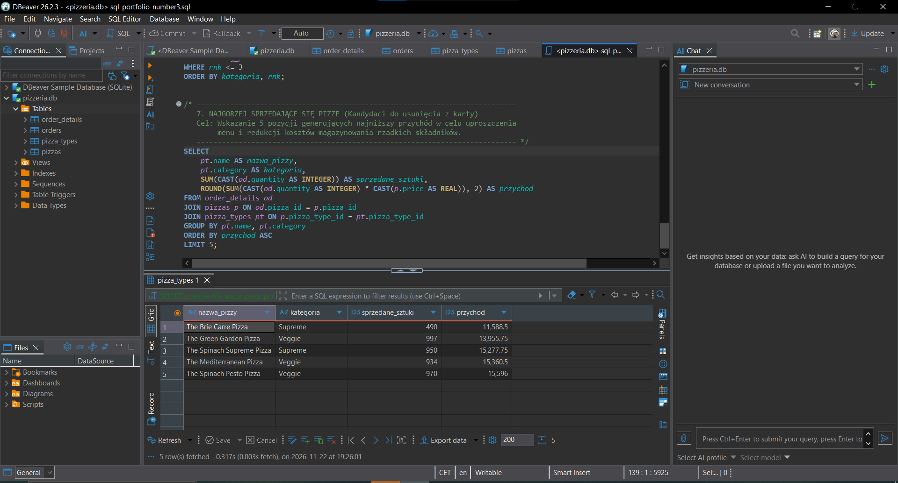

# 🍕 Analiza Sprzedaży Pizzerii (SQL Portfolio Project)

Kompleksowa analiza danych sprzedażowych pizzerii przeprowadzona w środowisku **SQLite / DBeaver** na relacyjnej bazie danych składającej się z 4 tabel (`orders`, `order_details`, `pizzas`, `pizza_types` – ok. 49 tys. rekordów).

## 🎯 Cel projektu
Celem analizy było zbadanie kondycji finansowej lokalu, identyfikacja szczytów obciążenia kuchni, ocena rentowności poszczególnych kategorii i rozmiarów pizz oraz wskazanie konkretnych rekomendacji biznesowych na podstawie danych.

## 🛠️ Wykorzystane umiejętności SQL
* **Łączenie tabel relacyjnych:** `INNER JOIN` na 4 powiązanych tabelach.
* **Agregacje i filtrowanie:** `GROUP BY`, `COUNT(DISTINCT ...)`, `SUM()`, `ROUND()`, rzutowanie typów `CAST()`.
* **Wyrażenia tablicowe (CTE):** `WITH` do budowania wieloetapowych zapytań.
* **Funkcje okna (Window Functions):**
  * `DENSE_RANK() OVER (PARTITION BY ...)` – wyznaczenie liderów sprzedaży w każdej kategorii osobno.
  * `LAG() OVER (ORDER BY ...)` – obliczenie dynamiki przychodów miesiąc do miesiąca (MoM %).
  * `SUM() OVER ()` – obliczenie procentowego udziału kategorii w całkowitym obrocie.
* **Analiza czasowa:** `strftime()` do grupowania zamówień po godzinach i miesiącach.

---

## 📊 Wyniki zapytań SQL (Podsumowanie i zrzuty ekranu)

### 1. Podstawowe KPI biznesowe

| Liczba zamówień | Sprzedane pizze | Łączny przychód | Średni koszyk (AOV) |
| :--- | :--- | :--- | :--- |
| `21 350` | `49 574` | `817 860,05 $` | `38,31 $` |

### 2. Sprzedaż według kategorii pizz

### 3. Analiza rozmiarów pizz

### 4. Godziny szczytu w pizzerii

### 5. Dynamika sprzedaży miesiąc do miesiąca (`LAG`)

### 6. Ranking Top 3 pizz w każdej kategorii (`DENSE_RANK`)

### 7. Najgorzej sprzedające się pizze

---

## 💡 Główne wnioski i rekomendacje biznesowe

1. **Optymalizacja grafiku pracowników (Godziny szczytu):**
   * Największy ruch przypada na okno lunchowe (**12:00–13:00** – blisko 5 000 zamówień) oraz wieczorne (**17:00–18:00** – ponad 4 700 zamówień).
   * *Rekomendacja:* Zwiększenie obsady kuchni i dostawców w tych dwóch blokach godzinowych oraz wprowadzenie promocji w godzinach popołudniowych (14:00–16:00).

2. **Zarządzanie rozmiarami w menu:**
   * Rozmiar **L** generuje ponad 45% całego przychodu (`375 318,70 $`), podczas gdy rozmiar **XXL** sprzedał się zaledwie w **28 sztukach** przez cały rok (`1 006,60 $`).
   * *Rekomendacja:* Wycofanie rozmiaru XXL z karty dań w celu redukcji kosztów magazynowania niestandardowych opakowań i składników.

3. **Uproszczenie menu (Najsłabsze pozycje):**
   * *The Brie Carre Pizza* (`490` sprzedanych sztuk, `11 588,50 $` przychodu) wyraźnie odstaje od reszty karty.
   * *Rekomendacja:* Usunięcie lub zastąpienie tej pozycji nowym produktem sezonowym, przy jednoczesnym mocnym promowaniu liderów swoich kategorii (*The Thai Chicken Pizza*, *The Classic Deluxe Pizza*).

---

## 📂 Struktura repozytorium
* [`sql_portfolio_number3.sql`](sql_portfolio_number3.sql) – pełny skrypt z 7 zapytaniami analitycznymi oraz komentarzami biznesowymi.
* `sql_portfolio1.png` – `sql_portfolio7.png` – zrzuty ekranu z wynikami poszczególnych zapytań w DBeaverze.
